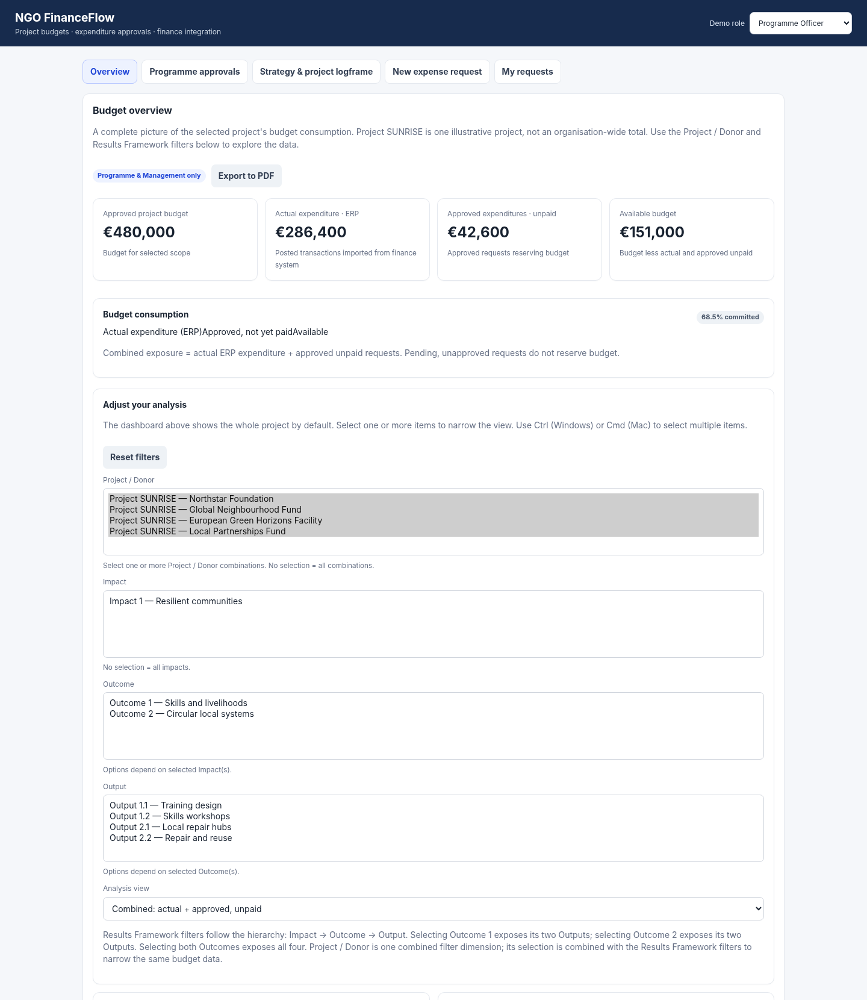
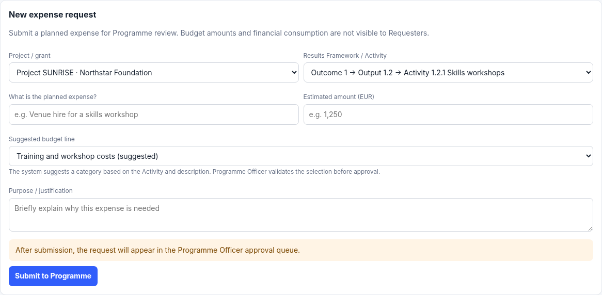
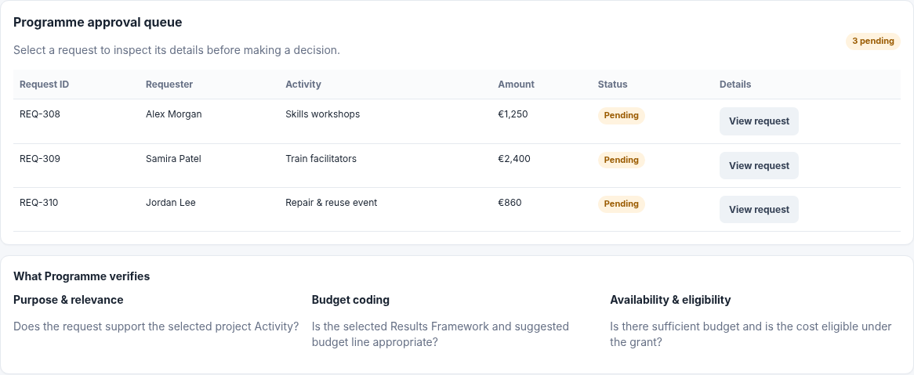
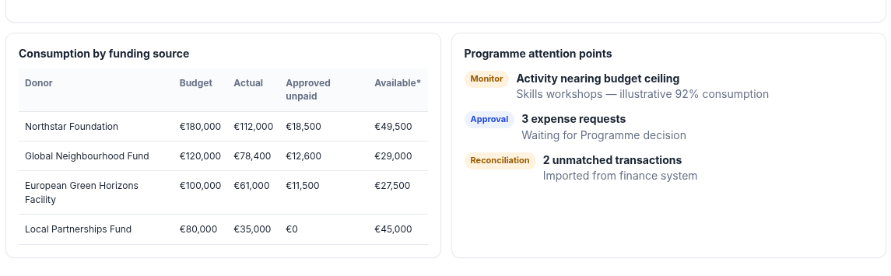

# NGO FinanceFlow
### AI-assisted functional prototype | Programme Budget & Expenditure Management

NGO FinanceFlow is a standalone functional prototype exploring how an NGO could connect programme budget management with its existing finance or ERP system.

The concept focuses on a practical operational challenge: tracking programme budgets and expenditure across a Results Framework and multiple funding sources, while coordinating expense requests, programme review and finance processing.

NGO FinanceFlow — Interactive Demo
Open the interactive FinanceFlow prototype: https://annbell-ngo.github.io/NGO-FinanceFlow/

## What the prototype demonstrates

- **Role-based workspaces** for Requester, Programme Officer, Management and Finance Officer.
- **Budget monitoring** with an Overview dashboard and filters across the Results Framework hierarchy and Project / Donor combinations.
- **Expense requests** linked to a project, grant and Results Framework activity.
- **Programme review** to approve requests or return them for correction with feedback.
- **Finance processing and reconciliation** as a separate step following programme approval.
- **Budget consolidation** showing budget, actual expenditure, approved unpaid requests and available balances by funding source.

## How to explore

1. Open [`index.html`](index.html) in a modern web browser.
2. Use the role selector in the top-right corner to switch between the available role views.
3. Explore the budget dashboard, submit a sample expense request and review the Programme and Finance workflows.

The prototype uses illustrative project and donor data. It is intended to demonstrate workflows and functional logic, not to represent a live NGO finance system.

## Selected screens

### Budget monitoring — Programme view

### Expense request

### Programme approval

### Budget consolidation

## AI-assisted development

I developed this interactive, standalone web prototype using HTML, CSS and JavaScript, with the assistance of a Large Language Model (LLM). I defined the operational problem, user roles, workflows and underlying business rules, and used the LLM as a development assistant to translate these requirements into working interface components and JavaScript functionality. I then iteratively tested and refined the prototype, including adjustments to the business logic and user flows.

## Scope and limitations

- This is a proof of concept with simulated data.
- It has no production backend, persistent database, authentication or live ERP/API integration.
- Role switching simulates different user views in the same browser; it is not real access control.
- Finance processing and ERP reconciliation are illustrative workflow simulations, not actual payment or accounting operations.

## Supporting document

The accompanying [PDF](NGO_FinanceFlow_AI_Assisted_Prototype.pdf) summarises the operational problem, proposed solution, selected business rules and prototype screens.
